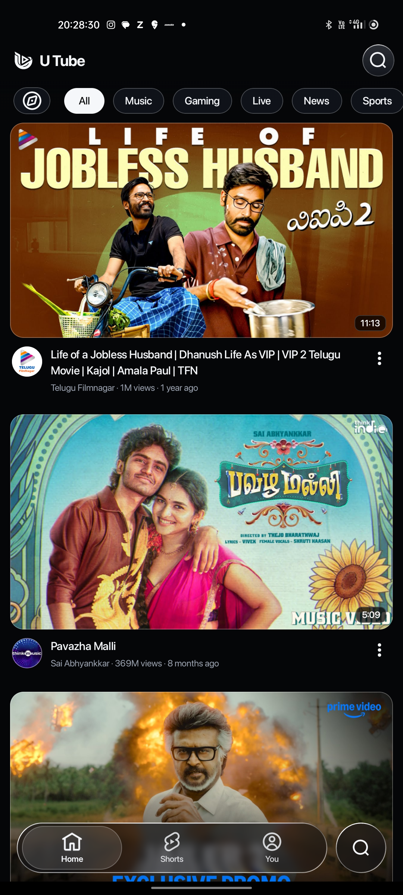
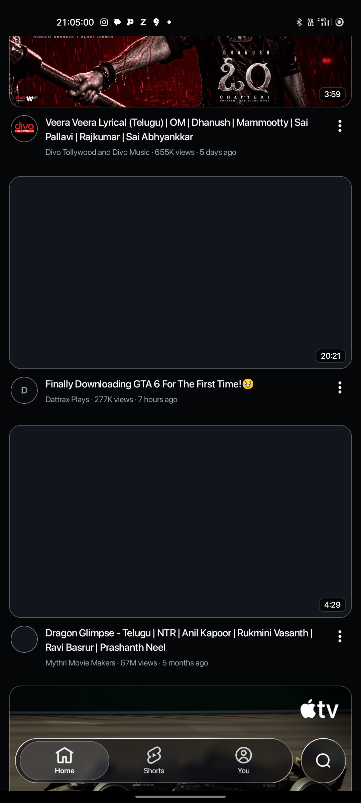
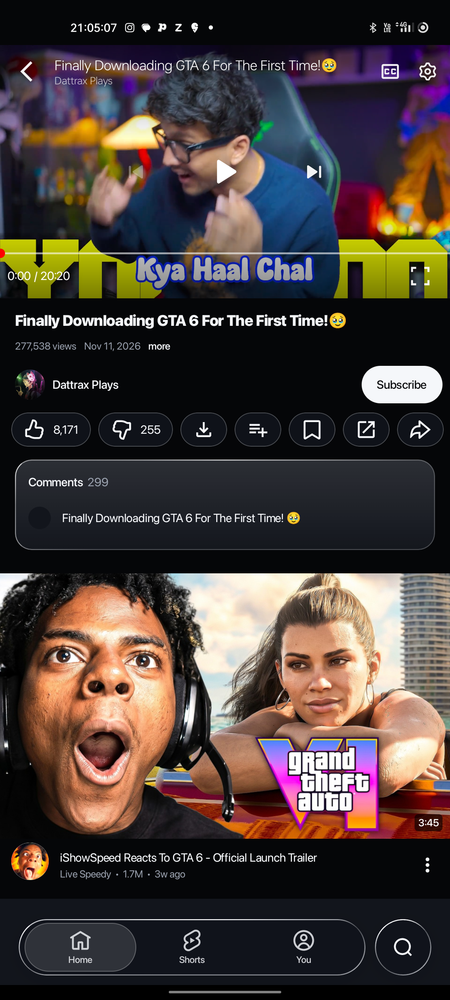
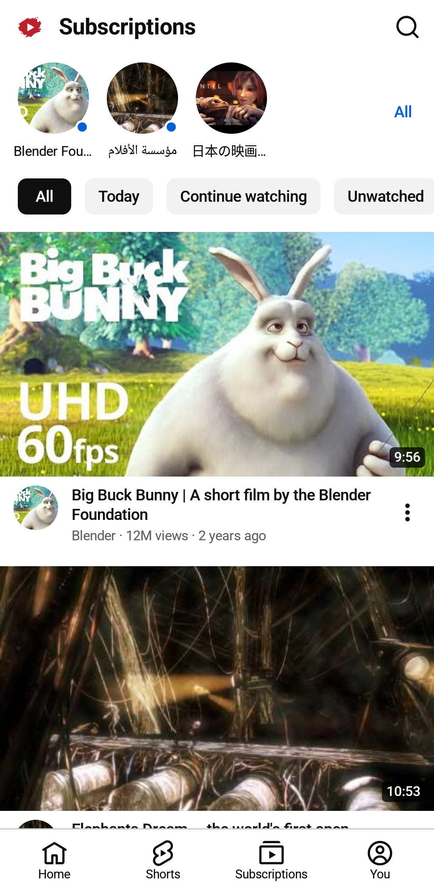

<div align="center">
  <h1><br>U Tube</h1>
  <p>An unofficial, open-source YouTube client for Android crafted with an iOS-inspired Liquid Glass interface.</p>

  <p>
    <a href="https://github.com/ajaykumarreddy-k/U-Tube/releases"></a>
  </p>

  <p>
    <a href="https://github.com/ajaykumarreddy-k/U-Tube/releases"></a>
    
    <a href="LICENSE"></a>
  </p>
</div>

Browse videos and Shorts, follow your favorite channels, and organize your playlists in an Android interface built with Jetpack Compose, **SF Pro Display** typography, and translucent **Liquid Glass** surfaces. Watch ad-free videos, listen in the background, use picture-in-picture, or save favorites for offline playback.

## Reference Repositories

U Tube builds on and draws directly from these two reference repositories:

1. [**LiTube**](https://github.com/HydeYYHH/litube) (`https://github.com/HydeYYHH/litube`) — **Codebase reference** providing the core Android Kotlin/Compose architecture, `MediaServiceCore` integration, Media3 playback engine, offline downloader, Cast/DLNA support, and upstream foundation (`upstream` remote).
2. [**Wavelet**](https://github.com/ajaykumarreddy-k/Wavelet) (`https://github.com/ajaykumarreddy-k/Wavelet`) — **Design & Liquid Glass reference** inspiring the translucent glass chrome, specular hairline highlights, floating navigation capsules, and optical surface hierarchy.

## Author

- [**ajaykumarreddy-k**](https://github.com/ajaykumarreddy-k) — Author of **U Tube** and [**Wavelet**](https://github.com/ajaykumarreddy-k/Wavelet).
- **Upstream Codebase:** [**HydeYYHH/litube**](https://github.com/HydeYYHH/litube) and [**HydeYYHH/MediaServiceCore**](https://github.com/HydeYYHH/MediaServiceCore).

## Previews

<p align="center">
  <a href=".github/assets/screenshots/v4-home.png"></a>
  &nbsp;
  <a href=".github/assets/screenshots/v4-search.png"></a>
  &nbsp;
  <a href=".github/assets/screenshots/v4-playback.png"></a>
  &nbsp;
  <a href=".github/assets/screenshots/v4-subscriptions.png"></a>
</p>

## Features

- **Liquid Glass iOS Experience.** Floating frosted glass bottom bar across `Home`, `Shorts`, and `You` alongside a detached glass `Search` orb, paired with **SF Pro Display** typography and smooth spring transitions.
- **Browse YouTube.** Swipe or tap smoothly between Home, Shorts, and You, search videos and channels, and explore playlists and watch history.
- **Play Your Way.** Enjoy ad-free Media3 playback with clean player controls, gesture seek/brightness/volume, video quality, speed, subtitles, audio tracks, background audio playback, picture-in-picture, and DLNA/Chromecast casting.
- **Download for Later.** Save videos, audio, subtitles, or entire playlists with selectable quality and pause/resume controls.
- **Keep Things Organized.** Build playback queues with shuffle, repeat, and autoplay. Watch history and Watch later work even while signed out.
- **Multiple Accounts, All in One.** Switch effortlessly between anonymous browsing and signed-in accounts.
- **Make It Yours.** Customize SponsorBlock, playback gestures, themes, and language, plus DeArrow support for cleaner titles and thumbnails.

## Downloads

Get Debug & Release APKs and release notes from [GitHub Releases](https://github.com/ajaykumarreddy-k/U-Tube/releases), or [build the app from source](#build-from-source).

**Requirements:** Android **7.0 / API 24** or later and an up-to-date **Android System WebView**. Picture-in-picture requires Android **8.0 / API 26** or later and a compatible device.

## Build from source

Use **JDK 21**, **Android SDK Platform 36**, and **Build Tools 36.0.0** to match the CI environment. The repository includes a **Gradle 8.11.1** wrapper.

Clone the repository (and optionally configure the `upstream` remote to track the LiTube codebase reference):

```sh
git clone https://github.com/ajaykumarreddy-k/U-Tube.git
cd U-Tube
git remote add upstream https://github.com/HydeYYHH/litube.git
```

Gradle downloads `MediaServiceCore` from JitPack using the version pinned in `gradle/libs.versions.toml`.

Set `ANDROID_HOME` to your Android SDK directory, or set `sdk.dir` in an untracked `local.properties` file. Then build the debug APK:

```sh
./gradlew :app:assembleDebug
```

On Windows, replace `./gradlew` with `.\gradlew.bat` in these commands.

The debug APK is saved to `app/build/outputs/apk/debug/app-debug.apk`. Debug builds use the application ID `com.hhst.litube.debug`; release builds use `com.hhst.litube`.

To build the release APK, run `./gradlew :app:assembleRelease`. The unsigned APK is saved to `app/build/outputs/apk/release/app-release-unsigned.apk`; sign it with your release key before distribution.

<details>
<summary><strong>Tests and verification</strong></summary>

Run unit tests and Android lint checks:

```sh
./gradlew :app:testDebugUnitTest :app:lintDebug
```

Build the instrumented test APK:

```sh
./gradlew :app:assembleDebugAndroidTest
```

Instrumented tests use local fixtures by default. To run live-service read checks, pass `network=1` as an instrumentation runner argument. See [CONTRIBUTING.md](CONTRIBUTING.md) and the [Android workflow](.github/workflows/android.yml) for device testing and release verification, including R8 checks.

</details>

<details>
<summary><strong>Tech stack</strong></summary>

U Tube is built with **Kotlin**, Jetpack Compose / Material 3, **AndroidX Media3**, **coroutines / StateFlow**, **Koin**, **Room**, **WorkManager**, and **OkHttp**.

Content and stream extraction are provided by [**MediaServiceCore**](https://github.com/HydeYYHH/MediaServiceCore).

</details>

## Contributing

U Tube is personally maintained by [ajaykumarreddy-k](https://github.com/ajaykumarreddy-k). Build and architecture notes live in [CONTRIBUTING.md](CONTRIBUTING.md).

If you run into an issue, [open an issue](https://github.com/ajaykumarreddy-k/U-Tube/issues) with your app version, device model, Android version, steps to reproduce, and a diagnostic archive if available.

## Acknowledgements

- [**LiTube**](https://github.com/HydeYYHH/litube) (`HydeYYHH/litube`) — Core Android YouTube client codebase reference.
- [**Wavelet**](https://github.com/ajaykumarreddy-k/Wavelet) (`ajaykumarreddy-k/Wavelet`) — Liquid Glass surface and UI design reference.
- [**MediaServiceCore**](https://github.com/HydeYYHH/MediaServiceCore) — Stream and feed extraction engine originally built for [**SmartTube**](https://github.com/yuliskov/SmartTube).
- [**NewTube**](https://github.com/aleixrodriala/newtube) — Inspiration and Cast protocol foundations (original license and attribution retained).
- Also built on AndroidX Media3, SponsorBlock, and DeArrow.

## Star History

<p align="center">
  <a href="https://www.star-history.com/?repos=ajaykumarreddy-k%2FU-Tube&type=date">
    <picture>
      <source media="(prefers-color-scheme: dark)" srcset="https://api.star-history.com/svg?repos=ajaykumarreddy-k/U-Tube&type=Date&theme=dark">
      <source media="(prefers-color-scheme: light)" srcset="https://api.star-history.com/svg?repos=ajaykumarreddy-k/U-Tube&type=Date">
      
    </picture>
  </a>
</p>

---

<p align="center">
  <strong>U Tube</strong> · Licensed under the <a href="LICENSE">GNU GPL v3.0</a>
</p>
